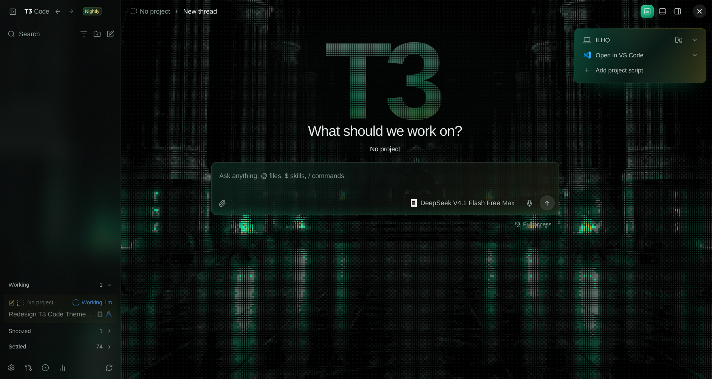
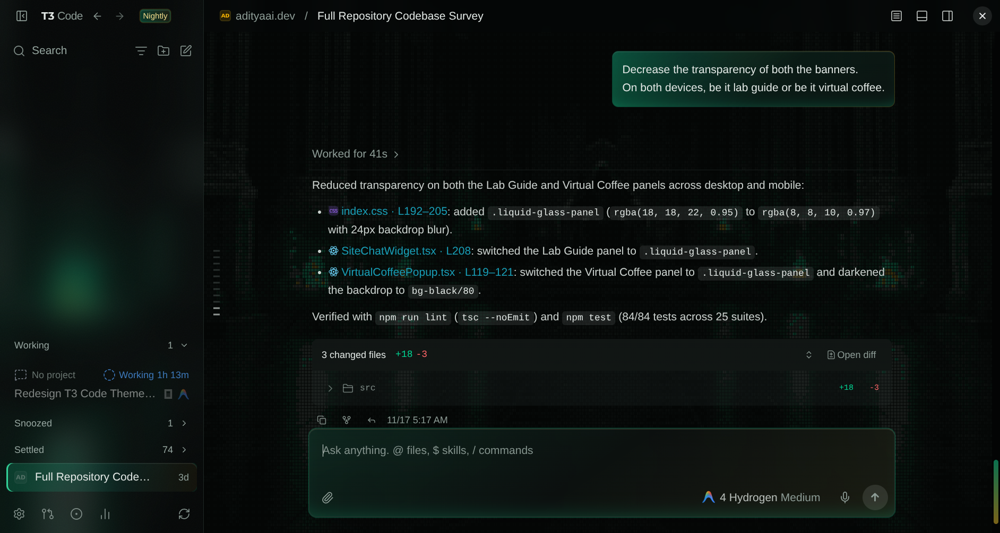
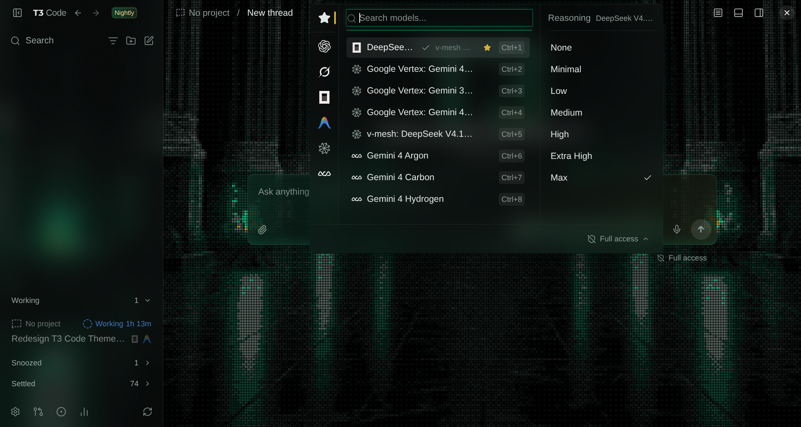
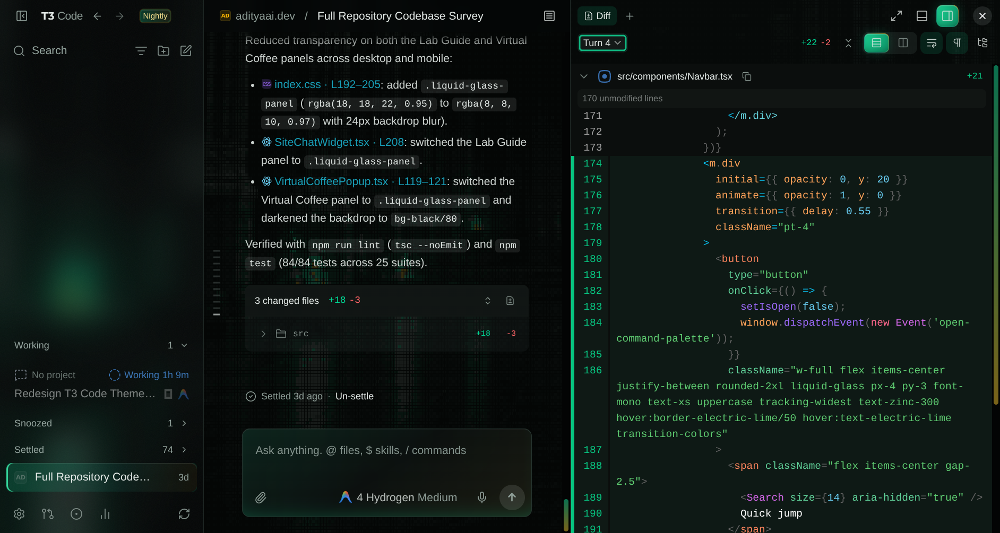
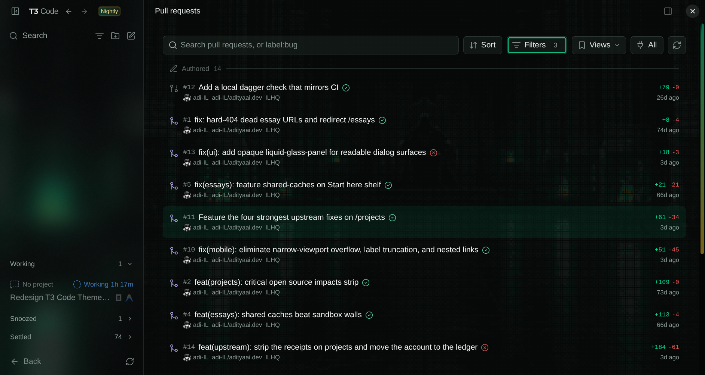
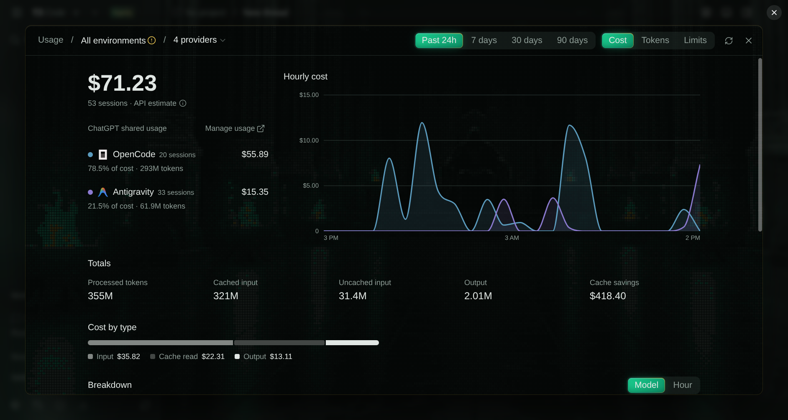
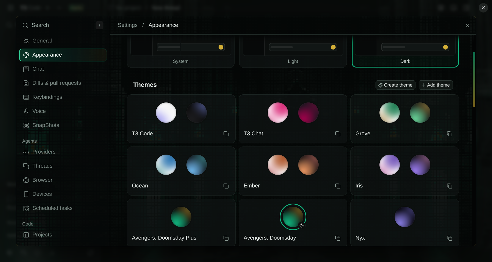
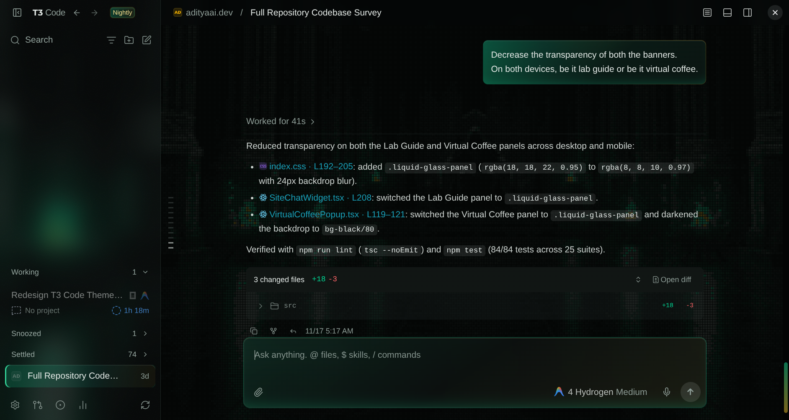
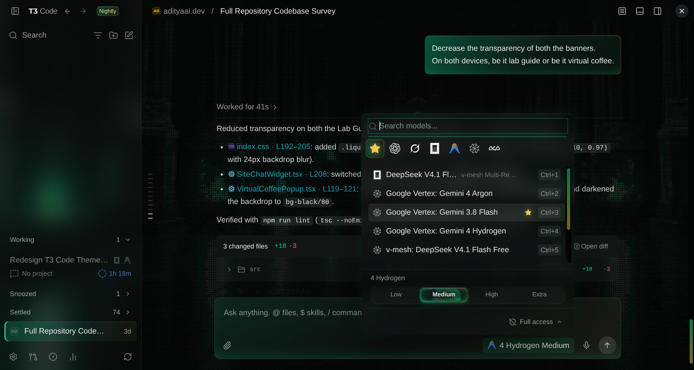

# Avengers: Doomsday

An obsidian, emerald, and imperial gold theme for [T3 Code](https://t3.codes). The background shows Doctor Doom on his throne in Latveria as a 13-color pixel matrix. Menus and panels keep the dark obsidian glass finish.









## Avengers: Doomsday Plus

Avengers: Doomsday Plus keeps the same artwork and adds two layout changes:

- **Title-first threads.** Each sidebar row puts the thread title on top, then the project and status, then the branch. Pinned and draft markers sit in front of the title.
- **A simpler model picker.** Search stays on top, followed by provider icons, the model list, and sliding glass keys for effort. The effort keys hide for models that have none. Fast is one toggle key, and favorite stars glow imperial gold.




## Install

Install one or both. Avengers: Doomsday changes colors and the background. Avengers: Doomsday Plus also changes the sidebar rows and the model picker. If you install both, T3 switches to the one you install last, and both remain in the theme picker.

```sh
curl -fsSL https://raw.githubusercontent.com/adi-IL/t3-avengers-doomsday-theme/main/avengers-doomsday.json -o avengers-doomsday.json
t3 theme set avengers-doomsday.json
```

```sh
curl -fsSL https://raw.githubusercontent.com/adi-IL/t3-avengers-doomsday-theme/main/avengers-doomsday-plus.json -o avengers-doomsday-plus.json
t3 theme set avengers-doomsday-plus.json
```

T3 switches right away in the desktop app and the browser. To reset, pick another theme in settings or run `t3 theme set t3-chat`.

### Let your agent install it

Paste this into a T3 Code thread:

> Install a theme from https://github.com/adi-IL/t3-avengers-doomsday-theme. Follow the "Instructions for agents" section of its README.

Your agent will ask whether you want Avengers: Doomsday, Avengers: Doomsday Plus, or both. Name your pick in the message to skip the question.

### Instructions for agents

1. This repo provides two themes. **Avengers: Doomsday** sets colors and the background. **Avengers: Doomsday Plus** adds title-first sidebar rows and a compact model picker. Both install side by side.
2. Unless the user already said "Avengers: Doomsday Plus", "plain Doomsday", or "both", ask which they want. If they want both, ask which one to activate last.
3. Download each chosen file from `https://raw.githubusercontent.com/adi-IL/t3-avengers-doomsday-theme/main/avengers-doomsday.json` or `https://raw.githubusercontent.com/adi-IL/t3-avengers-doomsday-theme/main/avengers-doomsday-plus.json`.
4. If the `t3` CLI is available, run `t3 theme set <path to file>` for each file. Otherwise call `t3_theme_set` with `themeId` set to `"avengers-doomsday"` or `"avengers-doomsday-plus"` and the file JSON as `theme`.
5. Each install switches T3 to that theme, so install the user's primary pick last.
6. Do not edit the generated JSON files. Both files stay close to T3's CSS length limit.

## Requirements

- A recent T3 Code Nightly (November 2026 or later).
- Works in the desktop app and the browser.

## Notes

- Avengers: Doomsday is dark only. It keeps T3 dark even when your system uses light mode.
- The glass panels follow the Glass opacity slider in Settings › Appearance. Screenshots use 80% opacity.
- The background fills the window at any size.
- If a T3 update changes its DOM structure, styled controls fall back to default appearance.

## Build locally

`theme.css` holds shared styles, and `plus.css` adds the Plus layout overrides. `art.py` encodes `assets/throne.png` as lossless WebP, and `build.py` writes `avengers-doomsday.json` and `avengers-doomsday-plus.json`.

```sh
python3 -m venv .venv
.venv/bin/pip install -r requirements.txt
.venv/bin/python build.py
.venv/bin/python verify.py
```

## License

[MIT](LICENSE)
